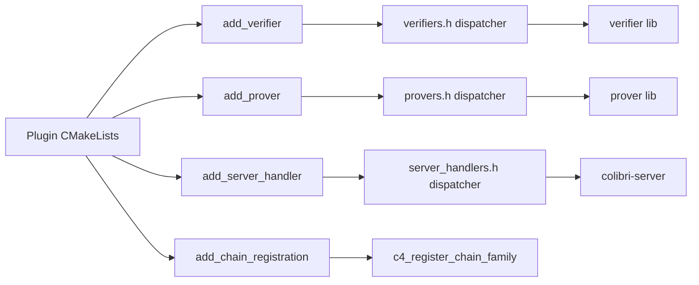
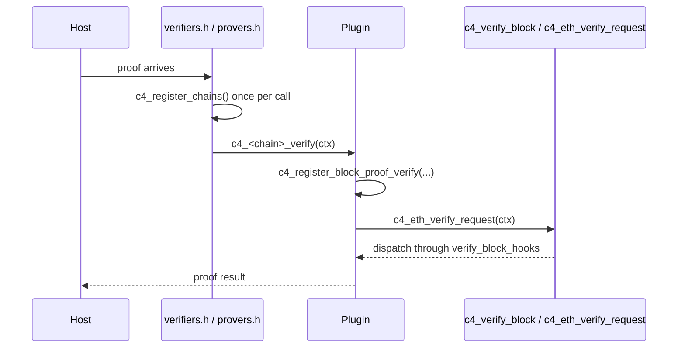

: Adding a chain

Colibri splits chain support into plugins. Every chain family lives in its own directory under `src/chains/` (or outside the tree via `EXTRA_CHAIN`) and plugs into the generated dispatchers through four CMake helpers and three runtime hook tables. This page documents the contract so a new chain, including a third-party one, can be added without forking the core.

## Where the plugin plugs in

The core compiles two static libraries, `verifier` and `prover`, with empty dispatchers. Every chain module registers:

* A `verify` function for its proof variants.
* A `proof` function that builds those proofs on the prover side.
* Optional runtime hooks for block, sync, and server integration.

Four CMake helpers from `src/chains/chains.cmake` generate the dispatchers and link the plugin library into the core:

| Helper                    | Builds                 | Required                              |
| ------------------------- | ---------------------- | ------------------------------------- |
| `add_verifier`            | `<name>_verifier` lib  | yes for proof-producing chains        |
| `add_prover`              | `<name>_prover` lib    | yes for proof-producing chains        |
| `add_chain_props`         | entry in `chain_props.h` | only if the server needs properties |
| `add_server_handler`      | `<name>_server_handler` | only if the chain ships a server    |
| `add_chain_registration`  | call before dispatch   | only if the plugin needs extra IDs    |



## CMake helpers

The helpers are declarative. Every argument is a function name the generated dispatcher will call. The functions themselves live in the plugin.

### add_verifier

```cmake
add_verifier(
  NAME             <chain>_verifier
  SOURCES          verifier/foo.c verifier/bar.c
  GET_REQ_TYPE     c4_<chain>_get_request_type
  VERIFY           c4_<chain>_verify
  METHOD_TYPE      c4_<chain>_get_method_type
  PROVER_PAYLOAD   c4_<chain>_get_prover_payload  # optional
  INIT_RPC_CTX     <chain>_init_rpc_ctx           # optional
  PROVER_CACHE_URL c4_<chain>_get_prover_cache_request # optional
  RESET_CACHES     c4_<chain>_reset_caches        # optional
  REGISTER_CHAIN   c4_<chain>_register_chain      # optional; JSON-driven runtime config
  CHAIN_TYPE       C4_CHAIN_TYPE_<CHAIN>          # required when REGISTER_CHAIN is set
  DEPENDS          util eth_verifier              # link dependencies
)
```

| Argument             | Signature                                                                                           | When called                                                                 |
| -------------------- | --------------------------------------------------------------------------------------------------- | --------------------------------------------------------------------------- |
| `NAME`               | -                                                                                                   | library name; must be unique                                                |
| `SOURCES`            | -                                                                                                   | plugin sources (globs allowed)                                              |
| `GET_REQ_TYPE`       | `const ssz_def_t* (chain_type_t)`                                                                   | pick SSZ request container; return `NULL` for foreign types                 |
| `VERIFY`             | `bool (verify_ctx_t*)`                                                                              | handle a proof; return `false` so the next verifier sees the request        |
| `METHOD_TYPE`        | `method_type_t (chain_id_t, char* method, json_t params, verify_flags_t)`                           | classify method; return `METHOD_UNDEFINED` to fall through                  |
| `PROVER_PAYLOAD`     | `bool (chain_id_t, const char*, const char*, verify_flags_t, buffer_t*, buffer_t*)`                 | rewrite RPC method/params before the prover sees them                       |
| `INIT_RPC_CTX`       | `void (c4_init_ctx_t*)`                                                                             | runs before each RPC; a good place to attach snapshots or register hooks    |
| `PROVER_CACHE_URL`   | `bool (chain_id_t, const char*, json_t, uint32_t, bool, bool, bytes_t, bytes_t, char**, uint32_t*)` | custom prover-cache URL                                                     |
| `RESET_CACHES`       | `void (void)`                                                                                       | clear verifier caches                                                       |
| `REGISTER_CHAIN`    | `bool (c4_state_t*, json_t)`                                                                        | runtime config handler; the generated `c4_register_chain` dispatcher routes to it (see "Registering chain configs at runtime") |
| `CHAIN_TYPE`         | `C4_CHAIN_TYPE_*` constant                                                                          | chain-type key that selects `REGISTER_CHAIN` in the dispatcher              |
| `DEPENDS`            | -                                                                                                   | other static libs to link publicly (always include `util`; EVM-L2s add `eth_verifier`) |

A verifier that only serves its own chain family must gate on `c4_chain_type(ctx->chain_id)`:

```c
bool c4_<chain>_verify(verify_ctx_t* ctx) {
  if (c4_chain_type(ctx->chain_id) != C4_CHAIN_TYPE_<CHAIN>) return false;
  return c4_eth_verify_request(ctx); // reuse the ETH pipeline for EVM-L2s
}
```

Returning `false` means "not my chain"; the next verifier runs. Returning `true` with an error in `ctx->state.error` signals a failed proof (the dispatcher stops).

### add_prover

```cmake
add_prover(
  NAME         <chain>_prover
  SOURCES      prover/foo.c prover/bar.c
  PROOF        <chain>_prover_execute
  RESET_CACHES c4_<chain>_reset_prover_caches  # optional
  DEPENDS      util eth_prover <chain>_verifier
)
```

| Argument       | Signature                     | When called                                                   |
| -------------- | ----------------------------- | ------------------------------------------------------------- |
| `PROOF`        | `bool (prover_ctx_t*)`        | build proof; return `false` so the next prover tries          |
| `RESET_CACHES` | `void (void)`                 | clear prover-side caches                                      |

### add_chain_props

```cmake
add_chain_props(FUNC c4_<chain>_chain_props)
```

The generated `c4_chains_get_props(chain_id_t, chain_properties_t*)` calls every registered provider under `#ifdef HTTP_SERVER`. Providers return `false` for foreign IDs.

### add_server_handler

```cmake
add_server_handler(
  NAME                        <chain>_server_handler
  SOURCES                     server/handler.c server/conf.c
  INIT_FUNC                   <chain>_server_init          # optional
  SHUTDOWN_FUNC               <chain>_server_shutdown      # optional
  CONFIG_FUNC                 <chain>_configure            # optional
  GET_DETECTION_REQUEST_FUNC  <chain>_get_detection_request # optional
  PARSE_VERSION_RESPONSE_FUNC <chain>_parse_version_response # optional
  GET_CLIENT_MAPPINGS_FUNC    <chain>_get_client_mappings   # optional
  METRICS_FUNC                <chain>_server_metrics        # optional
  REWRITE_BODY_FUNC           <chain>_rewrite_rpc_body      # optional
  DEPENDS                     <chain>_prover eth_server_handler
)
```

All nine functions are optional. The generated dispatchers call them in registration order. `REWRITE_BODY_FUNC` is a chain, each handler sees the body returned by the previous one.

### add_chain_registration

```cmake
add_chain_registration(FUNC <chain>_register_chains)
```

The function has signature `void (void)` and runs at the top of every verify/prove dispatch. It calls `c4_register_chain_family` and/or `c4_register_l1_for_l2`. See [Chain-ID registry](#chain-id-registry) below.

## Runtime hooks

The CMake helpers describe module-level plumbing. Per-proof behaviour runs through three function-pointer tables that are indexed by `chain_type_t` and have 16 slots. A type value `>= 16` is silently ignored, so new chain families must either pick a reserved enum value or stay within the first 15 slots.

| Hook                                | Owner             | Purpose                                                                     |
| ----------------------------------- | ----------------- | --------------------------------------------------------------------------- |
| `c4_register_block_proof_prover`    | prover            | build the EL-proof variant; also fetch the EL block                         |
| `c4_register_sync_data_prover`      | prover            | own the `sync_data` section (empty + `C4_SUCCESS` lets ETH keep going)       |
| `c4_register_block_proof_verify`    | verifier          | handle extra `ETH_EL_PROOF_UNION` variants (`sequencerProof`, `arbFeedProof`, …) |
| `c4_register_http_handler`          | server            | append to the HTTP-handler list                                             |
| `c4_register_internal_handler`      | server            | append to the internal-call list                                            |
| `c4_register_eth_rpc_list`          | server            | pin a dedicated RPC list for a chain id                                     |
| `c4_set_batch_poster_precheck`      | server            | single pointer (last registration wins)                                     |

Registrations are usually idempotent: every `c4_<chain>_verify` and `<chain>_prover_execute` call re-registers its hooks as a precaution. Core variants that stay in the ETH code path (`blockHash`, `clProof`, `witnessProof`, `eip2935`) do **not** go through the hook table; they live directly in `c4_verify_block`.



An EVM-L2 that just needs a new block-proof variant typically registers one entry in each table and forwards the rest of the request into `c4_eth_verify_request`. Non-EVM chains ignore the ETH entry points and implement everything themselves.

## Chain-ID registry

Chain-id routing is handled by `c4_chain_type(chain_id_t)` in [chains.c](https://github.com/corpus-core/colibri-stateless/blob/dev/src/util/chains.c). Built-in `switch` cases claim the OP-Stack list, every EEZ id and Arbitrum One. Everything else returns the high byte of the packed id (`CHAIN_ID(type, id)`).

For a chain whose id is not yet known to the core and does **not** control the high byte (for example a brand-new testnet or a sidechain the core does not list), the plugin registers the mapping at runtime. Ids that `chains.h` already declares as `C4_CHAIN_*` constants cannot be rerouted — they are hard-rejected to protect core routing. If a plugin needs to change the `chain_type_t` for a core id (e.g. teach Polygon PoS `137` to dispatch as `C4_CHAIN_TYPE_POLYGON` instead of `C4_CHAIN_TYPE_ETHEREUM`), that is an upstream change in `chains.h` / `chains.c`, not a plugin concern.

```c
void polygon_register_chains(void) {
  c4_register_chain_family(CHAIN(80002), C4_CHAIN_TYPE_POLYGON); // Amoy testnet (not built-in)
  c4_register_l1_for_l2   (CHAIN(80002), C4_CHAIN_SEPOLIA);      // if applicable
}
```

Rules:

* **Built-in ids are hard-rejected.** Any id declared as a `C4_CHAIN_*` constant in `chains.h` (every mainnet/testnet, all `C4_CHAIN_OP_*`, `C4_CHAIN_EEZ_*`, `C4_CHAIN_ARB_ONE`, `C4_CHAIN_POLYGON`, `C4_CHAIN_BSC`, Bolt, Haifa, Telos, Moon, Fuse, Cronos, Avalanche, …) cannot be rerouted through the registry — `c4_register_chain_family` returns `false` and the stored routing stays untouched. Plugins may only claim brand-new ids.
* The built-in `switch` cases in `c4_chain_type` run first; the registry is only consulted on the fallback branch for non-built-in ids.
* `chain_id == 0`, `type >= C4_BLOCK_PROOF_HOOKS` (`= 16`) and a full table (`C4_CHAIN_REGISTRY_MAX = 32`) are rejected.
* Calls are idempotent per `chain_id`; a second call with the same non-built-in id overwrites the stored type.
* The companion `c4_register_l1_for_l2` applies the same built-in guard to its `l2` argument and additionally rejects `l1 == 0`, so plugins cannot steer `TRY_AS_L1` or `c4_get_client_state` into a sentinel or hijack sync-committee state for a core chain.

The registration function is wired into both dispatchers through `add_chain_registration(FUNC polygon_register_chains)`; the generated `c4_register_chains()` helper fires at the top of `handle_verification`, `request_container`, `c4_get_method_type`, `c4_init_rpc_ctx` and `prover_execute`.

## Registering chain configs at runtime

`c4_register_chain_family` only answers the "what type is this id?" question. Most chain types also need a per-chain config block (sync-committee parameters, genesis-validators root, sequencer address, rollup proxy, …). Historically these configs lived in static C tables inside each plugin (`chain_data[]` for ETH, `op_chain_configs[]` for OP, `eez_chain_configs[]` for EEZ, hard-coded constants for ARB). Adding a new chain that uses an existing stack — e.g. a Luxor L1 that is ETH-compatible — required a C patch.

`c4_register_chain(c4_state_t* state, chain_type_t type, json_t data)` is a generic entry point that forwards the JSON config to a chain-type-specific handler. The dispatcher is generated into `verifiers.h` from the new `add_verifier` arguments:

```cmake
add_verifier(
  NAME eth_verifier
  ...
  REGISTER_CHAIN c4_eth_register_chain      # optional
  CHAIN_TYPE     C4_CHAIN_TYPE_ETHEREUM     # required when REGISTER_CHAIN is set
)
```

Each plugin owns its own JSON schema and its own extras table (built-in entries always win on lookup). ETH, EEZ, OP and ARB ship handlers out of the box; a plugin that invents a new `chain_type_t` can add one in the same way.

```c
// From the bindings (pseudo-code):
json_t      cfg = json_parse(...);
c4_state_t  s   = {0};
if (!c4_register_chain(&s, C4_CHAIN_TYPE_ETHEREUM, cfg)) {
  fprintf(stderr, "register_chain failed: %s\n", s.error);
  c4_state_free(&s);
  return -1;
}
```

Reference JSON per chain type:

* `C4_CHAIN_TYPE_ETHEREUM` — `chain_id`, `genesis_validators_root`, `fork_epochs` (`N` entries), `fork_versions` (`N+1` four-byte values); optional `slots_per_epoch_bits`, `epochs_per_period_bits`, `weak_subjectivity_epochs`, `zk_sync_keys_root`, `min_blob_base_fee`, `max_blobs_per_block_electra`, `blob_schedule`, `blob_params`. The generic `fork_version_func` reads from the `fork_versions` table.
* `C4_CHAIN_TYPE_EEZ` — `chain_id`, `rollup_id`, `proxy` (20-byte L1 proxy contract); optional `name`.
* `C4_CHAIN_TYPE_OP` — `chain_id`, `sequencer_address` (20 bytes). Prover-only fields (Kona ports, HTTP endpoint) remain at zero; they can be configured through the usual server-config path.
* `C4_CHAIN_TYPE_ARBITRUM` — `chain_id`, `sequencer_inbox` (20 bytes).

Rules:

* Chain ids already present in a plugin's built-in table are rejected; built-ins always win.
* Each extras table is capped (currently 8 entries per plugin). The call fails with a descriptive error once the table is full.
* The call is **not** idempotent at the plugin level: registering the same id twice fails.
* All inner tables (`fork_epochs`, `fork_versions`, `blob_schedule`, `blob_params`, OP sequencer bytes, EEZ `name`) are copied onto the heap and owned by the registry for the lifetime of the process.
* A matching `c4_<chain>_reset_chain_spec_registry` / `c4_<chain>_reset_chain_config_registry` is exported for tests only.
* The runtime registration does **not** register the chain family (routing). If the new id is not in the built-in `switch` of `c4_chain_type`, the caller must also invoke `c4_register_chain_family` so the request reaches the right verifier.

### Public binding entry point: `c4_configure_chain`

`c4_register_chain` operates on `json_t`, so bindings would need to pull in the SSZ/JSON headers just to build the payload. To avoid that, the stable public API in [`src/api/colibri.h`](https://github.com/corpus-core/colibri-stateless/blob/dev/src/api/colibri.h) exposes

```c
char* c4_configure_chain(const char* conf);
```

`conf` is a JSON object: a mandatory `"chain_type"` selector plus the fields from the schema above. `chain_type` accepts either the numeric `C4_CHAIN_TYPE_*` constant **or** one of the canonical strings `"ethereum"` / `"op"` / `"eez"` / `"arbitrum"` (aliases: `"eth"`, `"optimism"`, `"arb"`). The function returns `NULL` on success; otherwise a heap-allocated error message that the caller must `free()`.

Example payloads (one per chain type):

```json
{
  "chain_type": "ethereum",
  "chain_id":   42,
  "genesis_validators_root": "0x4b363db9...",
  "fork_epochs":   [0, 0, 0, 0, 0, 0, 1536],
  "fork_versions": [
    "0x00000000", "0x01000000", "0x02000000", "0x03000000",
    "0x04000000", "0x05000000", "0x06000000", "0x07000000"
  ]
}
```

```json
{ "chain_type": "op", "chain_id": 42069, "sequencer_address": "0x1234...1234" }
```

```json
{ "chain_type": "eez", "chain_id": 7777, "rollup_id": 1, "proxy": "0x1234...1234" }
```

```json
{ "chain_type": "arbitrum", "chain_id": 888001, "sequencer_inbox": "0x1234...1234" }
```

### JavaScript / TypeScript bindings

The `@corpus-core/colibri-stateless` client exposes custom chain registrations as an optional array on the `Config` object. Entries are forwarded to `c4_configure_chain` lazily on the first `rpc()` / `createProof()` / `verifyProof()` call and deduplicated across all `C4Client` instances sharing the same process.

```ts
import Colibri from '@corpus-core/colibri-stateless';

const client = new Colibri({
  chainId: 42, // our new fictional Ethereum-fork chain
  rpcs: ['https://rpc.example.net'],
  beacon_apis: ['https://beacon.example.net'],
  chain_configs: [{
    chain_type: 'ethereum',
    chain_id:   42,
    genesis_validators_root: '0x4b363db94e286120d76eb905340fdd4e54bfe9f06bf33ff6cf5ad27f511bfe95',
    fork_epochs:   [0, 0, 0, 0, 0, 0, 1536],
    fork_versions: [
      '0x00000000', '0x01000000', '0x02000000', '0x03000000',
      '0x04000000', '0x05000000', '0x06000000', '0x07000000'
    ]
  }],
});

const balance = await client.request({
  method: 'eth_getBalance',
  params: ['0xd8dA6BF26964aF9D7eEd9e03E53415D37aA96045', 'latest'],
});
```

See the `ChainRegistration` type in [`bindings/emscripten/src/types.ts`](https://github.com/corpus-core/colibri-stateless/blob/dev/bindings/emscripten/src/types.ts) for the full TypeScript shape. The per-handler fields (`fork_epochs`, `sequencer_address`, `proxy`, …) are documented above under *Reference JSON per chain type*.

## What a plugin may not change

Two things stay in the core and require an upstream patch:

* The `ETH_EL_PROOF_UNION` indices (`blockHash`, `clProof`, `sequencerProof`, `witnessProof`, `eezL1Proof`, `eip2935`, `arbFeedProof`). Variants are appended, never renumbered.
* The `chain_type_t` enum. Values 0–14 are reserved, 15 is a free slot a third party may use without editing `chains.h`. A new **named** type is a core change.

Everything else (new EL-proof variants in a non-ETH union, additional SSZ definitions, new RPC methods, caching) is plugin-local.

## EXTRA_CHAIN

Third-party plugins join a build via the `EXTRA_CHAIN` cache variable. It takes a comma-separated list; each entry is either a local path or a git URL (optionally with `#ref` to pin a branch or tag):

```bash
cmake -B build/default \
  -DEXTRA_CHAIN=/path/to/polygon-colibri,https://github.com/example/solana-colibri.git#v1
cmake --build build/default
```

Behaviour:

* The list is processed in [src/chains/CMakeLists.txt](https://github.com/corpus-core/colibri-stateless/blob/dev/src/chains/CMakeLists.txt), before `add_subdirectory(server)`. That is required so `add_server_handler` still reaches `SERVER_HANDLER_LIBS`.
* A git entry is cloned once into `${CMAKE_BINARY_DIR}/extra_chains/<repo>` with `git clone --depth 1`. An existing directory is reused (no pull); delete it to force a refetch.
* A missing clone or a missing `CMakeLists.txt` inside the plugin aborts configure.
* Plugin CMake runs with the build's own privileges. Only point `EXTRA_CHAIN` at code you trust.

### Plugin contract

A plugin repo must satisfy a few invariants so it can be dropped into any colibri tree:

1. A top-level `CMakeLists.txt`. **No** `project()` call; the plugin runs inside the enclosing configure.
2. One or more `add_verifier` / `add_prover` / `add_server_handler` / `add_chain_props` / `add_chain_registration` calls. `NAME` values must not collide with built-in libraries.
3. `GET_REQ_TYPE`, `VERIFY`, `METHOD_TYPE` and `PROOF` functions that return `NULL` / `false` / `METHOD_UNDEFINED` for chains they do not own.
4. Any new chain ID is claimed through `c4_register_chain_family`; any new L2/L1 relation through `c4_register_l1_for_l2`.
5. Include paths that reach the core always start from the absolute paths the CMake helpers already set (`${C4_SRC_DIR}/...`); the plugin's own headers stay in its local `verifier/`, `prover/`, `ssz/` or `server/` subdirs.
6. License awareness: the colibri core is MIT; `src/server/` is PolyForm Noncommercial. Plugin code that `#include`s server headers (via `add_server_handler`) ends up in the `colibri-server` binary alongside PolyForm code.
7. If the plugin needs SSZ types, add them in its own union; it may not renumber `ETH_EL_PROOF_UNION`.

### Minimal skeleton

```
polygon-colibri/
  CMakeLists.txt
  verifier/
    polygon_verify.c
    polygon_verify.h
  prover/
    polygon_prover.c
```

```cmake
# polygon-colibri/CMakeLists.txt

add_verifier(
  NAME        polygon_verifier
  SOURCES     verifier/polygon_verify.c
  GET_REQ_TYPE c4_polygon_get_request_type
  VERIFY       c4_polygon_verify
  METHOD_TYPE  c4_polygon_get_method_type
  DEPENDS      util eth_verifier
)

add_prover(
  NAME    polygon_prover
  SOURCES prover/polygon_prover.c
  PROOF   polygon_prover_execute
  DEPENDS util eth_prover polygon_verifier
)

add_chain_registration(FUNC polygon_register_chains)
```

```c
// polygon-colibri/verifier/polygon_verify.c
#include "chains.h"
#include "eth_verify.h"
#include "verify.h"

void polygon_register_chains(void) {
  // Polygon PoS mainnet (`CHAIN(137)` == `C4_CHAIN_POLYGON`) is built-in
  // and cannot be rerouted through the registry; only non-built-in ids may
  // be claimed. Amoy testnet is a fresh id:
  c4_register_chain_family(CHAIN(80002), C4_CHAIN_TYPE_POLYGON);
}

const ssz_def_t* c4_polygon_get_request_type(chain_type_t t) {
  return t == C4_CHAIN_TYPE_POLYGON ? eth_ssz_verification_type(ETH_SSZ_VERIFY_REQUEST) : NULL;
}

method_type_t c4_polygon_get_method_type(chain_id_t id, char* m, json_t p, verify_flags_t f) {
  return c4_chain_type(id) == C4_CHAIN_TYPE_POLYGON ? c4_eth_classify_method(m, p, f) : METHOD_UNDEFINED;
}

bool c4_polygon_verify(verify_ctx_t* ctx) {
  if (c4_chain_type(ctx->chain_id) != C4_CHAIN_TYPE_POLYGON) return false;
  return c4_eth_verify_request(ctx);
}
```

That is enough to make `colibri -c 137 eth_getBalance ...` route through the plugin. Extra variants (a Heimdall header, bor-style sequencer proofs, …) are added by registering `c4_register_block_proof_verify` and the matching prover hook.
