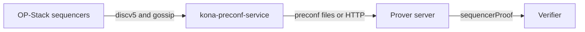

: OP-Stack

:: Kona-Bridge

The Kona Bridge collects OP-Stack preconfirmations from the sequencer's peer-to-peer network and stores them for the prover. It speaks the OP-Stack discovery and gossip protocols (`discv5` with ENRs, then GossipSub) through [kona-p2p](https://op-rs.github.io/kona/).

The bridge runs only next to the prover server. The verifier never joins the p2p network. It checks the `sequencerProof` signature against the configured sequencer address and does not need the bridge.

## What the server uses

The bridge writes preconfirmation payloads (optionally ZSTD-compressed, with the sequencer signature). The prover server reads those files when it builds a `sequencerProof`. If the file is missing and `MASTER_KONA_BRIDGE_URL` is set, the server fetches the same payload from that bridge over HTTP and caches a block-specific response locally.

The bridge is not linked into the verifier library. The in-process C FFI (`BUILD_KONA_BRIDGE`) is optional and off by default. The service that joins the p2p network is the standalone `kona-preconf-service` image:

```bash
docker build -f src/chains/op/kona_bridge/Dockerfile -t kona-preconf-service .
```

`CHAIN_ID` selects the network. Named presets exist for OP Mainnet (10), Base (8453), Unichain (130), Worldchain (480), and Zora (7777777). Gossip peers come from `kona_peers` for that chain id.

## Path into a proof



The verifier accepts the payload only when the recovered signer is the sequencer configured for that chain.
