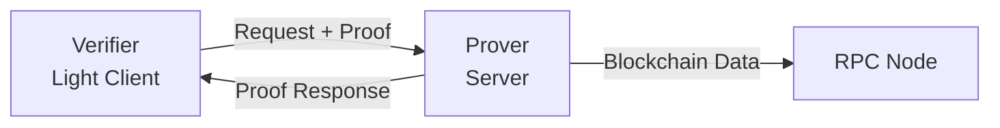
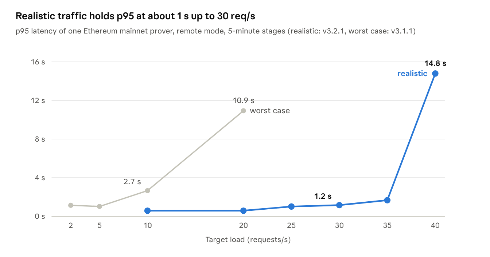

: Prover Service

This Docker image provides the **Colibri Prover Server**, the backend component of the Colibri Stateless ecosystem. It generates cryptographic proofs for blockchain data that can be verified by ultra-light clients.

## Quick Start

### Pull from GitHub Container Registry

```bash
# Latest release
docker pull ghcr.io/corpus-core/colibri-prover:latest

# Development version
docker pull ghcr.io/corpus-core/colibri-prover:dev

# Main branch
docker pull ghcr.io/corpus-core/colibri-prover:main

# Specific version
docker pull ghcr.io/corpus-core/colibri-prover:v1.0.0
```

### Run the Server

```bash
docker run -p 8090:8090 ghcr.io/corpus-core/colibri-prover:latest
```

The server will be available at `http://localhost:8090`.

## Available Tags

| Tag | Description | Platform | Update Frequency |
|-----|-------------|----------|------------------|
| `latest` | Latest stable release | amd64, arm64 | On version release |
| `vX.Y.Z` | Specific version (e.g., v1.0.0) | amd64, arm64 | Fixed version |
| `main` | Latest from main branch | amd64 | On every commit to main |
| `dev` | Development version | amd64 | On every commit to dev |

**Recommendation:** Use `latest` or a specific version tag (e.g., `v1.0.0`) for production deployments.

### Docker Compose

**Production setup with Memcached (recommended):**
```yaml
version: '3.8'

services:
  colibri-prover:
    image: ghcr.io/corpus-core/colibri-prover:latest
    pull_policy: always
    container_name: colibri_prover
    restart: unless-stopped
    init: true
    stop_signal: SIGTERM
    stop_grace_period: 120s
    ports:
      - "8090:8090"
    environment:
      - PORT=8090
      - CHAIN_ID=1
      - MEMCACHED_HOST=memcached
      - BEACON_EVENTS=true  # Proactively cache new blocks for fast 'latest' queries
      - RPC=https://eth-mainnet.g.alchemy.com/v2/YOUR_API_KEY,https://ethereum-rpc.publicnode.com
      - BEACON=https://lodestar-mainnet.chainsafe.io/
    healthcheck:
      test: ["CMD-SHELL", "curl -fsS http://127.0.0.1:$${PORT}/health || exit 1"]
      interval: 30s
      timeout: 5s
      retries: 3
      start_period: 60s
    depends_on:
      memcached:
        condition: service_healthy

  memcached:
    image: memcached:alpine
    container_name: memcached_prover
    restart: unless-stopped
    command: memcached -m 2048  # Limit memory to 2GB (adjust based on your needs)
    healthcheck:
      test: ["CMD", "sh", "-c", "echo stats | nc 127.0.0.1 11211"]
      interval: 10s
      timeout: 5s
      retries: 5
      start_period: 5s
```

**Memcached memory configuration:**
- `-m 512` → 512 MB (minimal setup)
- `-m 1024` → 1 GB (small-medium load)
- `-m 2048` → 2 GB (recommended for production)
- `-m 4096` → 4 GB (high-traffic environments)

Save this as `docker-compose.yml` and run:

```bash
docker compose up -d
```

**Note:** Using Memcached is **highly recommended** for production. The prover server caches almost all external requests in Memcached (TTL: 24h), which significantly reduces load on RPC/Beacon endpoints and improves response times.

### Performance Tips

For optimal performance in production:

1. **Enable Memcached** - Caches all external requests (24h TTL)
2. **Enable Beacon Events** (`BEACON_EVENTS=true`) - Proactively caches new blocks as they arrive
3. **Configure Memcached memory** - At least 2GB for production (`-m 2048`)
4. **Use multiple RPC/Beacon endpoints** - For redundancy and load balancing

**Result:** With this setup, `'latest'` queries are served from cache with minimal latency, and the server can handle high request volumes efficiently.

## Architecture

Colibri Stateless consists of two components:

- **Prover (this image)** - Backend server that generates cryptographic proofs
- **Verifier** - Ultra-light client that verifies proofs (available as bindings for JS/TS, Swift, Kotlin, Python)



The verifier can be integrated into:
- ✅ Web applications (JavaScript/TypeScript)
- ✅ Mobile apps (Swift, Kotlin)
- ✅ Desktop applications (Python)
- ✅ Embedded systems

## Features

- ✅ Ethereum Mainnet support
- ✅ Layer-2 support (Optimism, and more coming)
- ✅ Efficient proof generation with Merkle proofs
- ✅ BLS signature aggregation
- ✅ Sync committee proof support
- ✅ Lightweight single-threaded architecture (libuv)
- ✅ Built-in caching (~100MB internal cache)
- ✅ External caching via Memcached (recommended, 24h TTL)
- ✅ Stateless verification model

## Resource Requirements

The prover server itself is **lightweight** (uses libuv, single-threaded, ~100MB internal cache). Most load comes from fetching data and building Merkle proofs.

**For the Prover Server:**
- CPU: 1-2 cores
- RAM: 512 MB - 1 GB
- Storage: 1-5 GB (for data directory)

**For Memcached (recommended, caches external requests with 24h TTL):**
- RAM: 1-4 GB (configurable, see examples below)

**Recommended total for production setup (Prover + Memcached):**
- CPU: 2 cores
- RAM: 2-4 GB
- Storage: 10-20 GB

## Building Locally

If you want to build the image yourself:

```bash
docker build -t colibri-prover -f bindings/docker/Dockerfile .
```

## Multi-Architecture Support

Multi-platform images (both architectures) are **only available for releases**:
- `latest` - Latest stable release (linux/amd64, linux/arm64)
- `vX.Y.Z` - Version tags like v1.0.0 (linux/amd64, linux/arm64)

Development and main branch builds use single platform for faster builds:
- `main` - Main branch (linux/amd64 only)
- `dev` - Development branch (linux/amd64 only)

Docker will automatically pull the correct image for your platform. For production use, we recommend using a specific release tag to get multi-architecture support.

## Configuration

The server can be configured via:
- **Command-line flags:** `--port 8090` or `-p 8090`
- **Environment variables:** `PORT=8090` (recommended for Docker Compose)

### Key Configuration Options

| Option | Flag | Environment Variable | Default | Description |
|--------|------|---------------------|---------|-------------|
| Port | `-p, --port` | `PORT` | `8090` | Port to listen on |
| Chain ID | `-c, --chain_id` | `CHAIN_ID` | `1` | Chain ID (1=Mainnet, 10=Optimism) |
| Log Level | `-l, --log_level` | `LOG_LEVEL` | `0` | Log verbosity (0-3) |
| RPC Endpoints | `-r, --rpc` | `RPC` | (defaults) | Ethereum RPC (comma-separated) |
| Beacon Nodes | `-b, --beacon` | `BEACON` | (defaults) | Beacon nodes (comma-separated) |
| Data Directory | `-d, --data` | `DATA` | - | Data directory for caching |
| Memcached Host | `-m, --memcached_host` | `MEMCACHED_HOST` | `localhost` | Memcached hostname (highly recommended!) |
| Memcached Port | `-P, --memcached_port` | `MEMCACHED_PORT` | `11211` | Memcached port |
| Beacon Events | `-e, --beacon_events` | `BEACON_EVENTS` | `false` | Enable proactive caching via beacon event streaming (recommended for production) |

**Important caching notes:**

- **Memcached:** Almost all external requests are cached with a 24h TTL, dramatically reducing load on RPC/Beacon endpoints and improving response times.

- **Beacon Events (`BEACON_EVENTS=true`):** When enabled, the server proactively caches new blocks as soon as the Beacon API reports them. This means requests with `'latest'` get extremely fast responses from cache instead of fetching data on-demand. **Highly recommended for production!**

### Example with Custom Configuration (CLI)

```bash
docker run -p 8090:8090 \
  -v $(pwd)/data:/data \
  ghcr.io/corpus-core/colibri-prover:latest \
  /app/server \
    --port 8090 \
    --chain_id 1 \
    --log_level 2 \
    --rpc https://eth-mainnet.g.alchemy.com/v2/YOUR_API_KEY
```

### Example with Environment Variables

```bash
docker run -p 8090:8090 \
  -v $(pwd)/data:/data \
  -e PORT=8090 \
  -e CHAIN_ID=1 \
  -e RPC=https://eth-mainnet.g.alchemy.com/v2/YOUR_API_KEY \
  ghcr.io/corpus-core/colibri-prover:latest
```

Refer to the [main documentation](https://corpus-core.gitbook.io/specification-colibri-stateless) or run `--help` for all options.

## License

### ⚠️ Important License Information

This Docker image contains the **Colibri Prover Server**, which is licensed under a **dual-license model**:

**For Non-Commercial Use: PolyForm Noncommercial License 1.0.0**

- ✅ **Free for:**
  - Personal projects and research
  - Academic and educational use
  - Testing and evaluation
  - Non-profit organizations
  - Open source projects (non-revenue generating)

- ❌ **NOT allowed without commercial license:**
  - Commercial production use
  - Revenue-generating services
  - Enterprise deployments

**For Commercial Use: Commercial License Required**

If you plan to use this prover server for any commercial or revenue-generating purposes, you must obtain a commercial license.

📧 **Contact for commercial licensing:** [jork@corpus.io](mailto:jork@corpus.io)

**License Details:**
- License file: [src/server/LICENSE.POLYFORM](../../src/server/LICENSE.POLYFORM)
- Official text: [polyformproject.org/licenses/noncommercial/1.0.0](https://polyformproject.org/licenses/noncommercial/1.0.0/)

**Note:** The rest of the Colibri Stateless project (verifier library and bindings) is MIT-licensed and free for commercial use.

### Security

This image is built from source using GitHub Actions with:
- Regular security updates
- Minimal base image (Debian Bookworm Slim)
- No unnecessary dependencies
- Multi-stage build for smaller attack surface

## Use Cases

### For Verifier Developers

Use this prover server to provide proof data to your light client applications:

```typescript
// JavaScript/TypeScript Example
import Colibri from "@corpus-core/colibri-stateless";

const client = new Colibri({
  prover: ['http://your-prover-server:8090']
});

const block = await client.request('eth_getBlockByNumber', ['latest', false]);
console.log("Latest block:", block.number);
```

### For Infrastructure Providers

Run your own prover infrastructure to:
- Provide verified blockchain data to applications
- Reduce dependency on centralized RPC providers
- Enable trustless light client operations

## Related Packages

- **JavaScript/TypeScript:** [@corpus-core/colibri-stateless](https://www.npmjs.com/package/@corpus-core/colibri-stateless)
- **Python:** [colibri-stateless](https://pypi.org/project/colibri-stateless/)
- **Swift:** [Swift Package](https://github.com/corpus-core/colibri-stateless)
- **Kotlin/Java:** [Maven Central](https://central.sonatype.com/artifact/io.corpus.colibri/colibri-stateless)

## Documentation & Support

- **Full Documentation:** [corpus-core.gitbook.io/specification-colibri-stateless](https://corpus-core.gitbook.io/specification-colibri-stateless)
- **Source Code:** [github.com/corpus-core/colibri-stateless](https://github.com/corpus-core/colibri-stateless)
- **Issues & Support:** [GitHub Issues](https://github.com/corpus-core/colibri-stateless/issues)


:: Benchmarks

## Summary

With realistic client traffic, a single prover instance serves 30 requests/s in remote mode at a p95 latency of 1.2 s, using about 0.6 cores and 150–250 MB of RAM; capacity scales horizontally with multiple stateless instances behind a load balancer. All figures come from measurements on our production setup in November 2026 with version 3.2.1, which includes first event-loop optimizations; further improvements are planned (see Outlook).

| Metric | Value |
| --- | --- |
| Capacity per prover instance (remote mode) | 30 req/s with realistic traffic (plan 25); 8–10 req/s in the worst case (plan 7) |
| CPU | about 20 ms per request with realistic traffic; an instance saturates at about 0.75 cores |
| RAM per instance | 150–250 MB, short peaks up to about 650 MB |
| memcached per chain | 2–4 GB; at 4 GB no evictions in our tests |
| Requests to EL/beacon nodes per client request | about 2.2 with realistic traffic, mainly `eth_getProof` and `eth_createAccessList` for `eth_call` |
| Response size to the client | `eth_call` about 11 KB, `eth_blockNumber` 61 bytes to 1.2 KB; 16 KB on average in our realistic mix |
| Period store, Ethereum mainnet | 1.4 GB for about 2 years of history, grows about 0.7 GB/year |
| Period store, Gnosis | 2.9 GB for about 2.8 years of history, grows about 1 GB/year |
| Kona bridge per OP Stack chain | 0.15–0.2 cores, 170–330 MB; Base: about 0.45 cores, 2.5 GB |

The load on the prover depends heavily on the client mode: in hybrid mode only a fraction of it reaches the prover.

## Architecture

The prover is a stateless service that fetches chain data from the provider's execution and beacon nodes and combines it into proofs; its load is mostly I/O.

&#91;embedded content: Components of a prover deployment for one chain\]

- **Prover instances** are interchangeable, so the load balancer can distribute requests freely. Each instance runs an event loop for I/O and worker threads for building proofs, and keeps a 100 MB in-memory cache of Merkle tries.
- **memcached** caches almost all upstream responses for 24 hours and is shared by all instances of a chain.
- **Period store** keeps block roots and headers per sync period for historical proofs; a prover in slave mode syncs it from a master.
- **Kona bridge** is needed only for OP Stack chains: it collects sequencer preconfirmations from the peer-to-peer network and hands them to the prover.

## Client modes

The verifier in the client can use the prover in three modes; all capacity figures in this document apply to remote mode, the worst case for the prover.

| Mode | What the prover delivers | Load on the prover | Load on the provider's RPC/beacon nodes |
| --- | --- | --- | --- |
| local | nothing | none | client fetches all data directly |
| hybrid | block header proofs only, via GET | very low | client fetches execution data directly |
| remote | a complete proof for every RPC request | high, see Load behavior | indirect, through the prover |

In hybrid mode, responses are cacheable by a CDN: permanently for concrete block numbers (`immutable`), and with a 6 s TTL for `latest`. The prover also follows the beacon client's event stream and caches every new block ahead of time. Cache misses happen almost only for outdated clients that still need to fetch light client updates. Hybrid mode exists to scale to large request volumes.

## Baseline resource usage

Without client load, a prover needs almost no CPU; the largest steady consumer is the Kona bridge for OP Stack chains, especially Base. Values below are 24-hour averages from cAdvisor across our hosts, CPU in cores.

| Component | CPU avg | CPU p95 | RAM (RSS) |
| --- | --- | --- | --- |
| Prover, L1 chains (Ethereum, Gnosis) | 0.01–0.04 | up to 0.06 | 150–250 MB, short peaks up to 650 MB |
| Prover, L2 chains (OP Stack, Arbitrum) | 0.01–0.02 | 0.03 | under 20 MB |
| memcached | 0.01–0.02 | 0.04 | the configured limit |
| Kona bridge for OP Mainnet, Zora, Ink, Unichain | 0.15–0.21 | 0.24–0.31 | 170–330 MB |
| Kona bridge for Base | 0.42 | 0.46 | about 2.5 GB |

The L1 provers hold a fixed internal proof cache of 100 MB (Merkle tries of receipts and blocks), which accounts for most of their RAM. The Kona bridge joins the OP Stack peer-to-peer network to collect sequencer preconfirmations; it runs once per chain, next to the provers, and does not scale with client load.

## Load behavior and capacity

With realistic client traffic, one prover instance served 30-35 requests/s at a p95 latency of 1.2 s using about 0.6 cores; a worst-case mix saturates it at about 10 requests/s. We ran two profiles against one Ethereum mainnet instance in 5-minute stages of fixed request rates:

- **Realistic:** the method mix of a public RPC provider (Chainstack statistics, without `eth_chainId`, which the verifier answers locally): about 55 % `eth_call`, 13 % `eth_getTransactionReceipt`, 10 % `eth_blockNumber`, 7 % `eth_getBalance`, 5 % each `eth_getBlockByNumber` and `eth_getTransactionByHash`, 3 % `eth_getLogs`. Requests carry the client state and, for 70 % of them, the hash of the block the client already knows (`last_block_hash`); 80 % target the latest 64 blocks. Measured with v3.2.1, which includes first event-loop optimizations.
- **Worst case:** no client state, so a light client bootstrap (about 25 KB) is fetched and attached to every response; a mix dominated by full blocks, receipts and logs; half of the requests target older blocks up to two years back. Measured with v3.1.1.




| Profile | Target load | Achieved | p50 latency | p99 latency | CPU (cores) | Upstream requests/s |
| --- | --- | --- | --- | --- | --- | --- |
| realistic | 10 req/s | 9.7 req/s | 30 ms | 0.9 s | 0.16–0.22 | 18–20 |
| realistic | 20 req/s | 19.4 req/s | 52 ms | 1.2 s | 0.36–0.41 | 43–46 |
| realistic | 25 req/s | 24.3 req/s | 57 ms | 1.6 s | 0.50–0.58 | 53–56 |
| realistic | 30 req/s | 29.1 req/s | 67 ms | 1.6 s | 0.61–0.64 | 69–70 |
| realistic | 35 req/s | 34.0 req/s | 95 ms | 7.6 s | 0.72–0.78 | 77–82 |
| realistic | 40 req/s | 30.6 req/s (overload) | 190 ms | 21 s | up to 0.84 | unstable |
| worst case | 2 req/s | 1.8 req/s | 117 ms | 2.1 s | about 0.25 | 9.5 |
| worst case | 5 req/s | 4.5 req/s | 140 ms | 2.6 s | about 0.55 | 21 |
| worst case | 10 req/s | 9.1 req/s | 467 ms | 5.1 s | about 1.0 | 41 |
| worst case | 20 req/s | 15.4 req/s (overload) | 517 ms | 22 s | 0.8–1.0 | about 45 |

- **CPU per request:** about 20 ms with realistic traffic, 50–100 ms in the worst case. From about 30 requests/s the event loop is often fully busy, so an instance saturates at about 0.75 cores, well before using a full core.
- **Latency per method** (realistic, 30 req/s): `eth_blockNumber` p50 2 ms, p95 82 ms; `eth_getBlockByNumber` p50 4 ms, p95 95 ms; `eth_getLogs` p50 38 ms, p95 0.21 s; `eth_getTransactionReceipt` p50 0.10 s, p95 0.33 s; `eth_call` p50 83 ms, p95 1.4 s.
- **Response sizes** (realistic): `eth_call` 11 KB, `eth_getTransactionReceipt` and `eth_getBalance` 5 KB, `eth_getTransactionByHash` 3 KB, `eth_blockNumber` 1.1 KB, `eth_getLogs` 1–5 KB, `eth_getBlockByNumber` about 170 KB; 16 KB on average across the mix.
- **Overload:** these measurements were taken before load shedding existed. Beyond the saturation point requests queued up, latency rose to tens of seconds and the health check eventually restarted the instance. Since then the prover rejects requests early with 503 when its event loop is overloaded (see Overload protection), so a load balancer can move them to another instance.

For planning we use **25 requests/s per instance for realistic traffic** and 7 requests/s per instance for the worst case.

## Load on the upstream nodes

In remote mode, each client request triggers 2–4 requests to the execution and beacon nodes; memcached absorbs 40–75 % of them, depending on how often clients ask for the same data.

| Workload | Client load | Upstream requests | Per client request | memcached hit rate | Reaching the nodes per client request |
| --- | --- | --- | --- | --- | --- |
| Repetitive queries (integration test suite) | about 2 req/s | 3.6 req/s | 1.9 | 72–75 % | about 0.5 |
| Realistic profile (4 GB memcached) | 30 req/s | 69–70 req/s | 2.2–2.4 | 18–20 % | about 1.9 |
| Worst case, widely spread blocks | 10 req/s | 41 req/s | 4.1 | 39 % | about 2.5 |

With realistic traffic most upstream requests are `eth_getProof` and `eth_createAccessList`, both triggered by `eth_call`; with block-heavy traffic, beacon blocks (`/eth/v2/beacon/blocks`), beacon headers and `eth_getBlockReceipts` dominate. The prover received about 155 KB from the nodes per client request with realistic traffic and about 390 KB with block-heavy traffic. Upstream latency on our nodes was 5–30 ms per request at low load and rose to 60–140 ms on average at 30 client requests/s (`eth_getProof` about 140 ms); part of the requests went to a remote fallback provider. Nodes with lower latency mainly reduce client latency, see the note on node latency below.

**Node latency and capacity.** The prover waits for its nodes asynchronously, so node latency does not consume prover CPU and hardly changes the capacity per instance. It does add directly to client latency: an `eth_call` runs `eth_createAccessList` and then `eth_getProof` one after the other, so most of its latency is node time, while the prover itself spends about 20 ms of CPU. Faster nodes therefore lower p50 and p95 latency and the number of requests in flight. The nodes' own throughput for `eth_getProof` becomes the limit for the whole setup: 100 client requests/s cause about 80 `eth_getProof` and 60 `eth_createAccessList` calls per second at a low cache hit rate.

The low memcached hit rate in the realistic test comes from the test itself: almost every `eth_call` asked for a different address at the newest block, and each new block creates new cache keys. Real users concentrate on popular contracts and addresses, so we expect a higher hit rate in production.

Independent of client load, each prover also keeps a permanent connection to the beacon event stream, fetches every new block as it arrives, and periodically backfills the period store (see Storage).

## Storage

The only persistent storage that grows is the period store, which holds per sync period the block roots and headers needed for historical proofs; it currently takes 1.4 GB for Ethereum mainnet and 2.9 GB for Gnosis.

| Chain | Sync period length | Periods stored | History covered | Size | Per period | Growth per year |
| --- | --- | --- | --- | --- | --- | --- |
| Ethereum mainnet | about 27.3 h | 638 | about 2 years | 1.4 GB | about 2.2 MB | about 0.7 GB |
| Gnosis | about 11.4 h | 2,185 | about 2.8 years | 2.9 GB | about 1.3 MB | about 1 GB |

- The store only grows; retention can be capped if historical proofs are needed only for a limited time range.
- In slave mode (see Deployment) a prover fetches period data from a master on demand, so its local store stays small unless a full sync is configured.
- The Kona bridge stores preconfirmation payloads on disk but removes them after a TTL, so its storage does not grow.
- memcached and the prover cache live in RAM only.

We recommend 10–20 GB of disk per chain, which leaves room for several years of growth.

## Node requirements

In theory any beacon node that implements the Beacon API completely works, but only a few clients do so in practice; we recommend Lodestar or Nimbus, and Lodestar where clients use the `safe` or `justified` block tags.

**Beacon (consensus) client**

- A complete and correct Beacon API implementation. Recommended: Lodestar or Nimbus.
- Proofs for `historical_summaries` in the beacon state, needed for proofs of blocks older than the current sync committee period. Supported by Lodestar and Nimbus.
- Proofs from the beacon state for the justified checkpoint. When a client asks for the block tag `safe` or `justified`, the prover proves that the block really is that block. Currently only Lodestar offers the required endpoint.
- Light client API (`light_client/bootstrap`, `light_client/updates`).
- Server-sent event stream for `head` and `finalized_checkpoint`, used to cache new blocks ahead of time.

**Execution client**

- `eth_getProof` (EIP-1186) must return state at least back to the latest finalized block.
- The `debug` namespace must be enabled; the prover currently relies on it.
- `eth_getBlockReceipts`, `eth_getLogs`, `eth_createAccessList` and the standard block and transaction methods.
- For `eth_getProof` and `eth_call` on older blocks, the corresponding historical state.

Our [ETH Node Checker](https://beacon-check.colibri-proof.tech/) tests an execution or beacon endpoint and checks whether all RPC and Beacon API requests the prover needs are answered correctly. Several endpoints per client type can be configured as a comma-separated list; the prover balances requests by health and latency, and reports methods a node does not support through its metrics.

## Recommended deployment

Run one prover instance per 25 requests/s of expected peak traffic, at most one per CPU core, behind a load balancer, and share one memcached of 2–4 GB per chain between them. A single instance saturates below one core, so adding cores to one instance does not add capacity.

| Target load (remote mode) | Instances, realistic traffic | Instances, worst case | RAM incl. memcached | Egress to clients | Traffic from nodes |
| --- | --- | --- | --- | --- | --- |
| 10 req/s | 1 | 2 | 2.5–4.5 GB | about 1.5 Mbit/s | about 12 Mbit/s |
| 50 req/s | 2–3 | 7–8 | 3–6 GB | about 6.5 Mbit/s | about 60 Mbit/s |
| 100 req/s | 4–5 | 14–16 | 3–8 GB | about 13 Mbit/s | about 125 Mbit/s |

These are planning values based on 25 requests/s per instance for realistic traffic and 7 for the worst case; the traffic columns assume realistic traffic (worst case: about 8× the egress and 2.5× the node traffic). We recommend at least two instances per chain for redundancy. Add the Kona bridges for OP Stack chains on top (see Baseline resource usage). Placing the provers in the same network as the nodes keeps the upstream traffic local.

**Configuration**

- `MEMCACHED_HOST`: memcached with `-m 2048` to `-m 4096` and `-I 8m`, as some cached items exceed memcached's default item size limit of 1 MB.
- `BEACON_EVENTS=true`: caches new blocks as soon as the beacon client announces them, so `latest` queries are served from cache.
- `DATA`: a persistent volume for the period store.
- Slave mode via `period_master_url`: the prover fetches period store data from a master (we can provide ours) instead of building two years of history itself. Slaves do not generate the ZK proofs for sync committee transitions, so they need no proving key and incur no proving costs.
- Health checks: use `/ready` for the load balancer (503 while the instance is overloaded) and `/health` only for liveness, such as container restarts, with a generous timeout (for example 10 s and 5 retries). Restarting an overloaded instance turns a load peak into an outage.

## Overload protection

The prover protects itself against overload by rejecting new requests early, instead of queueing them until latency and memory run away. The signal is the smoothed event-loop lag, which measures how long a newly arrived request waits before the server even starts working on it.

| Setting | Default | Effect |
| --- | --- | --- |
| `C4_SHED_LAG_MIN_MS` | 50 | Above this smoothed loop lag, requests start being rejected with a rising probability |
| `C4_SHED_LAG_MAX_MS` | 250 | At this loop lag, all non-exempt requests are rejected (`0` turns lag-based shedding off) |
| `C4_MAX_OPEN_REQUESTS` | 1000 | Hard limit for concurrently open requests (`0` = unlimited) |

- Rejected requests get HTTP `503` with `Retry-After: 1` and `Connection: close`.
- Never rejected: `/health`, `/ready`, `/metrics`, `/version`, `/period_store` (used by slave provers), `GET /proof/...` (hybrid mode, mostly served from cache) and `eth_blockNumber`.
- `GET /ready` returns `503` while the instance rejects all requests, so the load balancer can take it out of rotation until it recovers.
- The defaults are first values and will be calibrated with further load tests; `colibri_event_loop_lag_ewma_seconds` shows the lag the thresholds act on.

**Load balancer configuration.** Proof requests are sent as `POST`, and most load balancers do not retry `POST` requests on another server by default. Proof requests are idempotent, so retrying them is safe.

nginx:

```nginx
upstream colibri_mainnet {
    server 10.0.0.11:8090 max_fails=0;
    server 10.0.0.12:8090 max_fails=0;
}
server {
    location / {
        proxy_pass http://colibri_mainnet;
        proxy_next_upstream error timeout http_503 non_idempotent;
        proxy_next_upstream_tries 2;
    }
}
```

`max_fails=0` keeps nginx from marking an instance as failed after a single 503 from load shedding.

HAProxy:

```
backend colibri_mainnet
    option httpchk GET /ready
    http-check expect status 200
    retry-on 503 conn-failure empty-response response-timeout
    retries 2
    option redispatch 1
    server p1 10.0.0.11:8090 check inter 2s fall 2 rise 2
    server p2 10.0.0.12:8090 check inter 2s fall 2 rise 2
```

Load shedding protects against too many requests, not against single expensive ones, such as an `eth_call` that touches thousands of storage slots. Limits per request are planned (see Outlook); volumetric attacks should be handled at the load balancer or CDN, for example with rate limits per client IP.

## Monitoring

Each prover exposes Prometheus metrics at `/metrics`; the event-loop idle ratio is the best single signal that an instance is reaching its limit.

| Metric | What it tells you |
| --- | --- |
| `colibri_event_loop_idle_ratio` | Share of time the event loop is idle; near 0 means the instance is saturated |
| `colibri_event_loop_lag_ewma_seconds` | Smoothed event-loop lag that load shedding acts on |
| `colibri_open_requests` | Currently open client requests |
| `colibri_requests_shed_total` | Requests rejected with 503 because the instance was overloaded |
| `colibri_public_requests_total`, `colibri_public_errors_total` | Client requests and errors |
| `colibri_method_requests_total`, `colibri_method_duration_milliseconds_total`, `colibri_method_size_bytes_total` | Requests, total time and response bytes per method; label `type` separates client (`public`) from upstream (`eth`, `beacon`) calls |
| `colibri_eth_requests_total`, `colibri_beacon_requests_total` and their `_cached_total` | Upstream requests and how many were served from memcached |
| `colibri_server_healthy`, `colibri_server_ewma_latency_ms` | Health and latency of each configured node |
| `colibri_method_unsupported_servers` | Methods a configured node does not support |
| `colibri_process_resident_memory_bytes`, `colibri_process_cpu_*_seconds_total` | Memory and CPU of the process |
| `colibri_period_sync_lag_slots` | How far the period store lags behind the chain head |

We also recommend the standard memcached exporter: a steady eviction rate (`memcached_items_evicted_total`) means memcached is too small.

## Outlook

We are working on raising the capacity per instance, so the figures in this document are a conservative baseline rather than a ceiling.

- **Event loop:** moving parsing and serialization of large upstream responses from the event loop to worker threads, so that one instance can use more than one core.
- **Limits per request:** caps on the number of storage slots and accounts per proof, on block ranges and results for `eth_getLogs`, and a deadline per request, so that single expensive requests cannot occupy an instance.
- **Latency metrics:** histograms per method, so p95 and p99 latency can be monitored directly.

We will share updated measurements once these changes are released.
